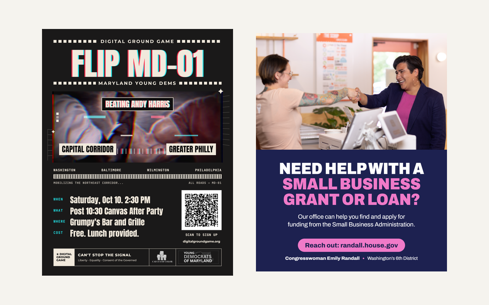
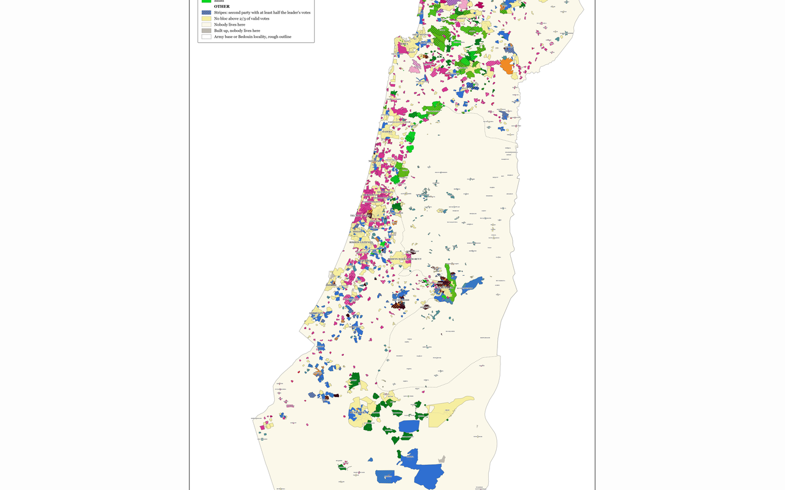
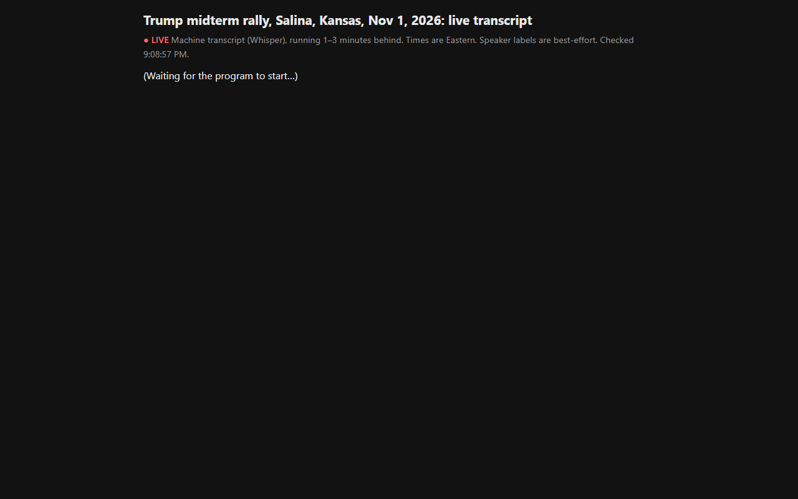

### Hi, I'm Ben Adams 👋

Political communications, campaign graphics and election data.

<table>
<tr>
<td width="50%" valign="top">

 <b><a href="https://github.com/benjamingaleadams/Digital-Portfolio">Digital Portfolio</a></b> 
Campaign and organizing graphics: event posters and social posts.
</td>
<td width="50%" valign="top">

 <b><a href="https://israelielections.org">Extremely Detailed Israeli Elections</a></b> 
Knesset results by CBS statistical area, 2006–2026. <a href="https://github.com/benjamingaleadams/extremely-detailed-israeli-elections">Site</a> · <a href="https://github.com/benjamingaleadams/israel-map">Data &amp; scripts</a>
</td>
</tr>
<tr>
<td width="50%" valign="top">

 <b><a href="https://github.com/benjamingaleadams/salina-rally-transcript">Salina Rally Live Transcript</a></b> 
Live machine transcript of the Nov 1, 2026 Salina, Kansas rally.
</td>
<td></td>
</tr>
</table>
